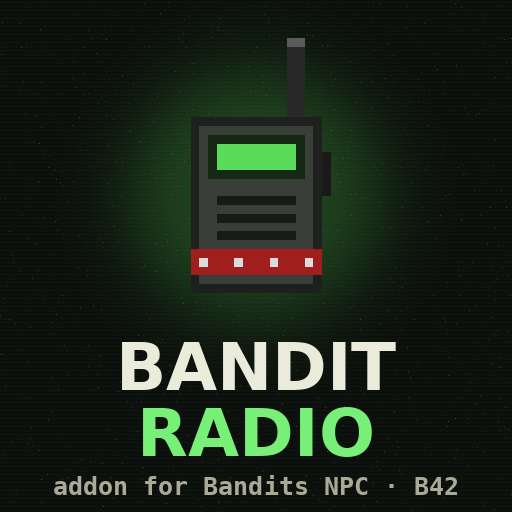
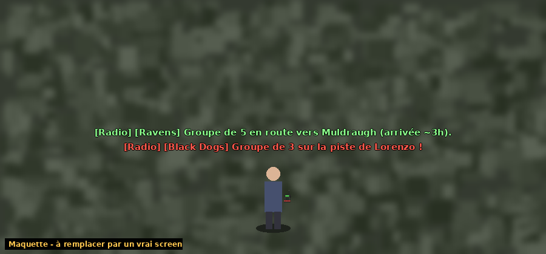
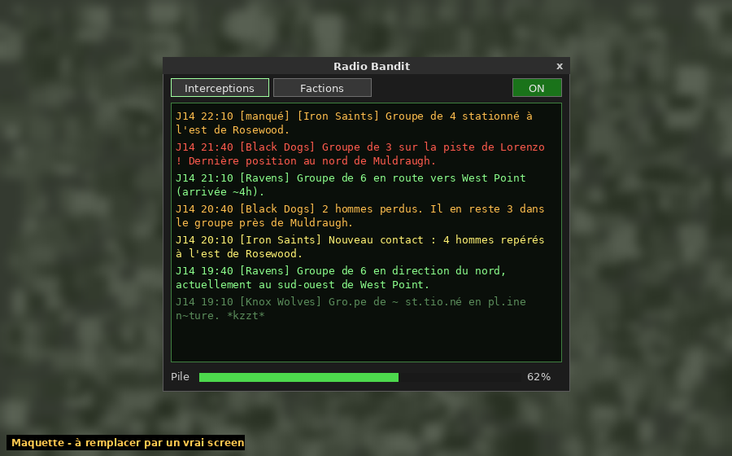
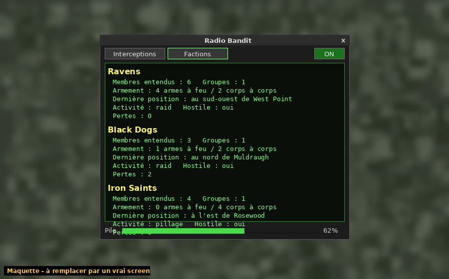
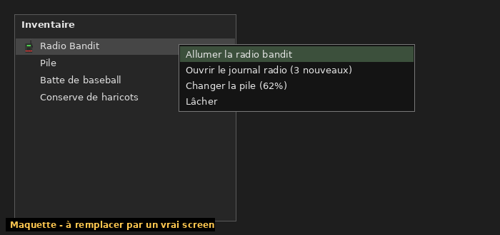

<p align="center">
  
</p>

<h1 align="center">Bandit Radio</h1>

<p align="center">
  <b>An open-source addon for <a href="https://steamcommunity.com/sharedfiles/filedetails/?id=3268487204">Bandits NPC (v2)</a> — Project Zomboid Build 42</b><br>
  Loot a bandit's walkie-talkie, tune into their frequency, and know where every faction is heading.
</p>

<p align="center">
  
  
  
  
</p>

<p align="center"><a href="#-version-française">🇫🇷 Version française plus bas</a></p>

---

## What it does

Bandits roam Knox County in organised clans. Bandit Radio lets you listen in to them.

- 📻 **Two ways to use it**, like a vanilla portable radio:
  - **Radio ON**: intercepts appear **live above your character**, colour-coded (red = a group is hunting a player).
  - **Radio OFF** (but carried): messages are still **saved to the radio log**, marked *[missed]*, and you can read them later in the interface.
- 📦 **New item: Bandit Radio.** Sometimes dropped by killed bandits, rarely found in police stations, army surplus and electronics stores.
- 🛰️ **Movement intercepts.** The mod follows every bandit group over time and works out where it is going:
  - toward a **town** (with an estimated arrival time),
  - toward a **player** it is hunting,
  - in a **direction** across the wilds,
  - or **holding position** somewhere.
- 🗂️ **Faction intel.** For each clan you have heard: how many members, how many groups, firearms vs melee, last known position, current activity, hostility and losses.
- 📉 **Event reports.** New contacts, men lost after a fight, groups that go silent.
- 🔋 **Battery & range.** The radio drains while you listen. Swap in a standard battery to recharge it. Only transmissions within range are heard, and far ones get garbled by static.
- 🌍 **FR / EN** in-game, multiplayer-ready (the server analyses, each client formats messages in its own language).

## Screenshots

> ⚠️ These are **mockups** of the interface. Replace them with in-game captures before release.

**Radio ON - live messages above the player**



| Radio log (Intercepts) | Factions |
|---|---|
|  |  |



## Installation

**Steam Workshop:** subscribe to *Bandits NPC* and *Bandit Radio*, then enable both (Bandits must load first).

**Manual / from GitHub:**
1. Download or clone this repo.
2. Copy the whole folder to `C:\Users\<you>\Zomboid\Workshop\BanditRadio\` (Linux/macOS: `~/Zomboid/Workshop/BanditRadio/`).
3. Enable **Bandits NPC** and **Bandit Radio** in the Mods menu.

## How to use

1. Get a Bandit Radio (kill bandits, or search police / army / electronics loot).
2. Right-click it in your inventory:
   - **Turn on bandit radio**: live messages above your head. Drains the battery.
   - **Open radio log**: opens the interface, even when the radio is off. The counter shows how many messages you missed.
3. Reports arrive at every scan (every 30 in-game minutes by default).
4. The **Factions** tab gives a summary of every clan within range.
5. Out of battery? Carry a **Battery** and right-click → **Replace battery**. A switched-off radio uses no battery but still logs messages.

The radio works from your inventory or any bag you carry. The **ON/OFF** button in the interface also switches it on and off.

## Sandbox options

| Option | Default | Description |
|---|---|---|
| Listening range | 1500 tiles | Max distance of heard transmissions |
| Scan interval | 30 min | How often bandit movements are analysed |
| Drop chance | 8 % | Chance a killed bandit drops a radio |
| Battery life | 36 h | In-game hours of listening per battery |
| Exact coordinates | off | Show `(x, y)` instead of "north of Muldraugh" |
| Static interference | on | Far messages get garbled |
| World loot | on | Radios spawn in world containers |
| Overhead messages | on | Radio ON: show intercepts above the player |
| Log when off | on | Radio OFF but carried: save intercepts as *missed* |

## How it works

```
Contents/mods/BanditRadio/42/media/lua/
├── shared/BanditRadio/
│   ├── BR_Config.lua    -- options, town list, FR/EN strings, geo helpers
│   ├── BR_Adapter.lua   -- ONLY file that talks to Bandits (brain, clan, weapons, target)
│   └── BR_Intel.lua     -- pure logic: clustering, tracking, destination guess, reports
├── server/BanditRadio/
│   └── BR_Server.lua    -- periodic scan, network broadcast, loot
└── client/BanditRadio/
    ├── BR_Client.lua    -- radio state, battery, range, static
    ├── BR_Window.lua    -- UI (Intercepts / Factions)
    └── BR_ContextMenu.lua
```

1. Every *Scan interval*, the **server** lists the loaded bandits through `BR_Adapter`.
2. `BR_Intel` groups them by clan and proximity, matches each group to the previous scan, and works out the heading. It then checks whether the group targets a player, or whether a town lies inside a 30° cone ahead and is getting closer.
3. Structured reports are broadcast to clients. Each client keeps only what is in range of its player, then formats, garbles and displays it.

> **Note:** like the game itself, the mod only "hears" bandits in **loaded areas** (around players). Groups that leave the loaded zone are reported as *went silent*.

### Compatibility with Bandits updates

Bandits has no documented public API. All access goes through `BR_Adapter.lua`, every call is wrapped in `pcall`, and each one has a fallback:
- bandit detection: `BanditBrain.Get(zombie)` → fallback `zombie:getVariableBoolean("Bandit")`
- clan name: Bandit Creator clan name → fallback to a stable generated name
- weapons: `brain.weapons` → fallback to the item in hand

If a Bandits update breaks something, `BR_Adapter.lua` is the only file to fix.

## Roadmap

- [ ] Real in-game screenshots
- [ ] Map markers for last known positions
- [ ] Radio static sound effect
- [ ] Persist faction intel across server restarts (ModData)
- [ ] More languages (PR welcome!)
- [ ] Verify coordinates of B42 towns (Ekron, Irvington, Brandenburg, Echo Creek)

## Contributing

PRs are welcome, see [CONTRIBUTING.md](CONTRIBUTING.md). Easy first contributions:
- add or fix towns in `BanditRadio.Locations` (`BR_Config.lua`)
- add a language in `BanditRadio.Strings` + `Translate/<LANG>/`
- map more Bandits program names in `BR_Window.lua`

## Credits

- **Slayer** for [Bandits NPC](https://steamcommunity.com/sharedfiles/filedetails/?id=3268487204). This addon only *uses* Bandits and contains none of its code.
- Bandit Radio by **Lorenzo**. [MIT License](LICENSE).

---

## 🇫🇷 Version française

**Bandit Radio** est un addon open source pour **Bandits NPC (v2)** sur Project Zomboid B42.

**Le principe :** tu récupères la radio d'un bandit, tu te mets sur leur fréquence, et tu sais ce que fait chaque faction autour de toi.

- **Deux modes** :
  - **Radio allumée** : les messages s'affichent **en direct au-dessus du perso**, comme une radio portable vanilla.
  - **Radio éteinte** (mais sur toi) : les messages sont quand même **enregistrés dans le journal**, marqués *[manqué]*, et tu les lis plus tard dans l'interface.
- **Interceptions** : nouveaux contacts, groupes en route vers une ville (avec heure d'arrivée estimée), groupes qui traquent un joueur, groupes stationnés, pertes après un combat, groupes qui ne répondent plus.
- **Fiches de faction** : nombre de membres, groupes, armes à feu ou corps à corps, dernière position, activité, hostilité, pertes.
- **Pile et portée** : la radio consomme sa pile pendant l'écoute (une pile classique la recharge). Les messages lointains sont brouillés.
- Fonctionne en **solo et en multijoueur**, en **français et en anglais**.

**Utilisation :** clic droit sur la radio →
- *Allumer la radio bandit* : messages en direct au-dessus du perso (consomme la pile)
- *Ouvrir le journal radio (X nouveaux)* : l'interface, utilisable même radio éteinte
- *Changer la pile* : il faut une pile sur soi

**Installation :** abonne-toi à *Bandits NPC* et *Bandit Radio* sur le Workshop, ou copie ce dossier dans `Zomboid/Workshop/BanditRadio/`, puis active les deux mods.

Les options (portée, intervalle d'analyse, chance de drop, autonomie, coordonnées exactes, brouillage, loot) sont réglables dans les **options sandbox**.

Contributions bienvenues : villes, traductions, corrections. Voir [CONTRIBUTING.md](CONTRIBUTING.md).
