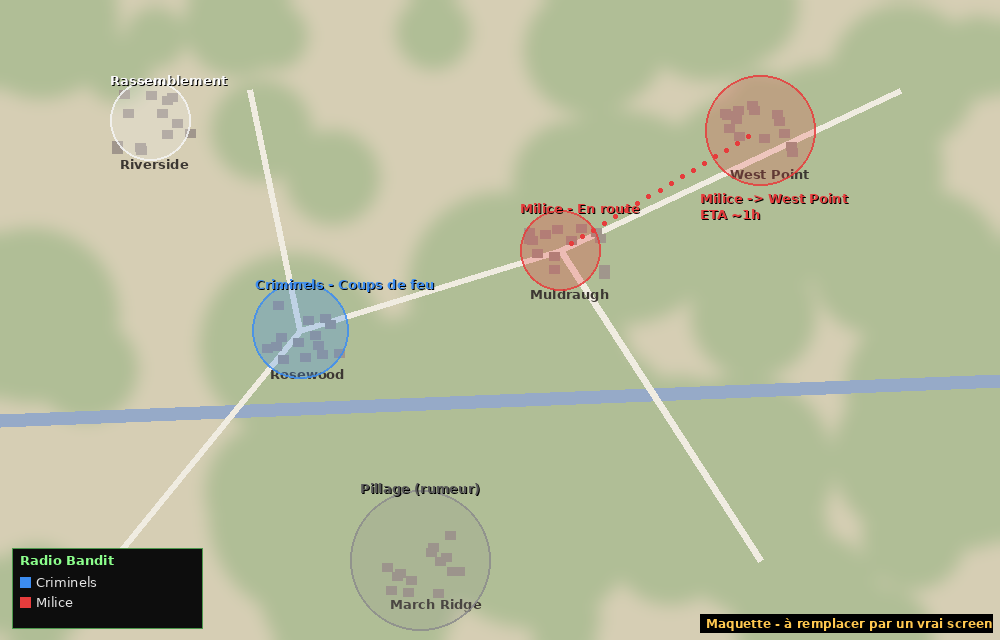

<p align="center">
  
</p>

<h1 align="center">Bandit Radio</h1>

<p align="center">
  <b>An open-source addon for <a href="https://steamcommunity.com/sharedfiles/filedetails/?id=3268487204">Bandits NPC (v2)</a> — Project Zomboid Build 42</b><br>
  Loot a bandit's walkie-talkie, tune into their frequency and know everything they do around you.
</p>

<p align="center">
  
  
  
  
  
</p>

<p align="center"><a href="#-version-française">🇫🇷 Version française plus bas</a></p>

---

## What it does

Bandits roam Knox County in organised clans. With a **Bandit Radio**, anything they do within range goes out on their frequency, and you hear it.



### 📡 Every bandit activity is reported

| Category | Events |
|---|---|
| **Movement** | new contact · trip **from A to B with ETA** · moving in a direction · arrival · camp set up · resting · reinforcements · several groups **gathering** |
| **Looting** | group looting a building (gas station, police station, pharmacy, farm…) |
| **Combat** | **gunshots** · fighting zombies · **overrun by a horde** · **clash between two factions** |
| **Players** | a group **hunting** a player · a group **closing in** on a player (with ETA) |
| **Losses** | men lost · group **wiped out** (bodies and loot left behind) · group gone silent |
| **Ambient** | random radio chatter, static, and optional **false rumors** |

Positions are **vague on purpose**: "near a gas station in Muldraugh", "outside Rosewood". You never get exact coordinates.

### 🎚️ Reliability: full intel, partial info or rumors
Pick how much you can trust the radio:

| Mode | What you get |
|---|---|
| **Complete** (default) | every event, in full detail |
| **Realistic** | a mix: *"[Militia] 5 men are looting the gas station in Muldraugh"* / *"[???] Someone is looting a gas station"* / *"(rumor) Heard breaking glass near Muldraugh"*… or nothing at all |
| **Rumors only** | vague information only |

Add **false rumors** (0–50 %) and you can never fully trust what you hear. A weak signal (far away) also downgrades full intel to partial info.

### 🗺️ Live map overlay
- Each intercept becomes a **blurry zone** on the world map and minimap, **coloured by faction** (grey = rumor, white = unknown faction).
- Trips are drawn as **dotted paths** to the target town, with a live **ETA countdown**.
- Faction **legend**, and zones that fade and disappear after a configurable time.

### 📻 Two ways to listen
- **Radio ON**: intercepts appear live **above your character**, colour-coded (red = someone is hunting a player).
- **Radio OFF** (but carried): messages are still saved to the **radio log** as *[missed]*.
- **Radio window**: *Intercepts* log, *Factions* tab (members, groups, weapons, last position, activity, losses), **Map ON/OFF**, **AUTO / FR / EN** language and **ON/OFF** buttons.

### 🔋 And more
- **Bandit Radio item**: dropped by killed bandits, rarely found in police / army / electronics loot.
- Battery system (any standard battery), listening range, distance-based static.
- Clean, translated faction names (`12_Militia` → *Militia* / *Milice*).
- Singleplayer & multiplayer: the server analyses, each client formats messages in its own language.

## Screenshots

> ⚠️ **Mockups.** To be replaced with in-game captures.

| Live messages above the player | Radio log |
|---|---|
|  |  |

| Factions | Context menu |
|---|---|
|  |  |

## Installation

**Steam Workshop:** subscribe to *Bandits NPC* and *Bandit Radio*, then enable both (Bandits first).

**From GitHub:** download the latest [release](../../releases), extract it to `C:\Users\<you>\Zomboid\Workshop\` and enable both mods.

## How to use

1. Get a Bandit Radio (kill bandits, or search police / army / electronics loot).
2. Right-click it:
   - **Turn on bandit radio**: live messages above your head (drains the battery)
   - **Open radio log (X new)**: log, factions, map toggle and language
   - **Replace battery**: needs a battery in your inventory
3. Open the map (**M**) to see the zones.

## Sandbox options

| Option | Default | Description |
|---|---|---|
| Listening range | 1500 tiles | Max distance of heard transmissions |
| Scan interval | 30 min | How often bandit activity is analysed |
| Information reliability | Complete | Complete / Realistic / Rumors only |
| False rumors | 0 % | Chance per scan of a fake rumor |
| Ambient chatter | 15 % | Chance per scan of a flavour message |
| Events: movements / looting / combat / players / losses / ambient | on | Toggle each category |
| Map zones | on | Show intel zones on the map |
| Map zones lifetime | 12 h | How long a zone stays on the map |
| Drop chance | 8 % | Chance a killed bandit drops a radio |
| Battery life | 36 h | In-game hours of listening per battery |
| Static interference | on | Far messages get garbled |
| World loot | on | Radios spawn in world containers |
| Messages above player | on | Radio ON: show intercepts overhead |
| Log when off | on | Radio OFF but carried: save intercepts |

## Customize it

Everything is meant to be changed:

| File | What you can change |
|---|---|
| `shared/BanditRadio/BR_Messages.lua` | **Every radio message**, for each event and detail level, in each language. Lists = random variants |
| `shared/BanditRadio/BR_Config.lua` | Towns, building types, faction names and colours, UI strings |
| `shared/BanditRadio/BR_Intel.lua` (top) | Detection settings: group radius, horde size, camp delay, gathering size… |

### API for other mods

```lua
require "BanditRadio/BR_API"
local API = BanditRadio.API

API.addTown("My Village", 5000, 7000)
API.addClanName("cartel", { EN = "Cartel", FR = "Cartel" })
API.setFactionColor("Cartel", 0.9, 0.1, 0.9)

-- A new event type, with its messages
API.addMessages("EN", "convoy", { full = "Convoy of {n} vehicles {pos}!", rumor = "Engines heard {area}." })
API.addDetector("convoy", function(state, groups, scan, emit)
    for _, g in ipairs(groups) do
        if g.vehicle >= 3 then emit(g, "convoy") end
    end
end)

-- Client side: react to every intercept (sound, Discord relay, achievements...)
API.onReport(function(report, text) print(text) end)
```

## How it works

```
media/lua/
├── shared/BanditRadio/
│   ├── BR_Config.lua    -- options, towns, places, faction names/colours, UI strings
│   ├── BR_Messages.lua  -- all radio messages (editable templates)
│   ├── BR_Adapter.lua   -- ONLY file that talks to Bandits
│   ├── BR_Intel.lua     -- event engine (pure logic, testable outside the game)
│   └── BR_API.lua       -- public API
├── server/BanditRadio/BR_Server.lua    -- scan + broadcast + loot
└── client/BanditRadio/
    ├── BR_Client.lua    -- radio state, battery, range, static, log
    ├── BR_Map.lua       -- world map / minimap overlay
    ├── BR_Window.lua    -- radio window
    └── BR_ContextMenu.lua
```

1. Every *scan interval*, the **server** reads every loaded bandit through `BR_Adapter`: position, clan, weapon, target, vehicle, sleep, building, plus the zombies around.
2. `BR_Intel` groups bandits by clan and proximity and tracks each group between scans by its members. It compares positions, headcounts, targets and nearby zombies to detect events.
3. Each event gets a detail level (reliability) and is broadcast. Each client keeps what is in range, formats it in its language, shows it overhead or in the log, and draws it on the map.

> Like the game itself, the mod only "hears" bandits in **loaded areas** (around players).

**Bandits compatibility:** Bandits has no public API, so every call goes through `BR_Adapter.lua`, wrapped in `pcall`, with a fallback. If a Bandits update breaks something, that is the only file to fix.

## Roadmap
- [ ] Real screenshots
- [ ] Radio static sound + `onReport` sound pack
- [ ] Persist intel across server restarts
- [ ] Jam a faction's frequency / broadcast fake info to lure a clan
- [ ] More languages (PR welcome!)

## Contributing
See [CONTRIBUTING.md](CONTRIBUTING.md). Easy first PRs: messages, translations, towns, building types, faction names.

## Credits
- **Slayer** for [Bandits NPC](https://steamcommunity.com/sharedfiles/filedetails/?id=3268487204). This addon only *uses* Bandits and contains none of its code.
- Bandit Radio by **Lorenzo**. [MIT License](LICENSE).

---

## 🇫🇷 Version française

**Bandit Radio** est un addon open source pour **Bandits NPC (v2)** sur Project Zomboid B42. Récupère le talkie d'un bandit, cale-toi sur leur fréquence, et tu sauras tout ce qu'ils font autour de toi.

**Tout est signalé :**
- **Déplacements** : contact, trajet **de A vers B avec l'heure d'arrivée**, arrivée, camp, repos, renforts, **rassemblements**
- **Pillages** de bâtiments (station-service, commissariat, pharmacie, ferme…)
- **Combats** : **coups de feu**, combats contre les zombies, groupe **débordé par une horde**, **affrontements entre factions**
- **Joueurs** : groupe qui **traque** ou **se rapproche** d'un joueur
- **Pertes**, groupes **anéantis** (corps et loot sur place), groupes silencieux
- **Ambiance** et **fausses rumeurs** (optionnel)

**Fiabilité réglable :** *Complète* (tout en détail), *Réaliste* (mélange d'infos complètes, partielles, de rumeurs et de silences) ou *Rumeurs uniquement*. Un signal faible dégrade aussi l'info.

**Carte :** chaque info devient une **zone floue colorée par faction** sur la carte et la minicarte, avec les **trajets en pointillés**, l'**heure d'arrivée qui défile** et une légende. Les zones s'effacent avec le temps.

**Deux modes :** radio allumée, les messages s'affichent **au-dessus du perso** ; radio éteinte, ils vont dans le **journal** en *[manqué]*. La fenêtre a un bouton **Carte ON/OFF**, un bouton de langue **AUTO / FR / EN**, et les onglets *Interceptions* et *Factions*.

**Modifiable :** tous les messages sont dans `BR_Messages.lua`, et villes, bâtiments, noms et couleurs de factions dans `BR_Config.lua`. Une **API** permet à d'autres mods d'ajouter des villes, des factions ou de nouveaux types d'événements.

**Installation :** abonne-toi à *Bandits NPC* et *Bandit Radio* sur le Workshop, ou télécharge la [release](../../releases) et extrais-la dans `Zomboid/Workshop/`.
